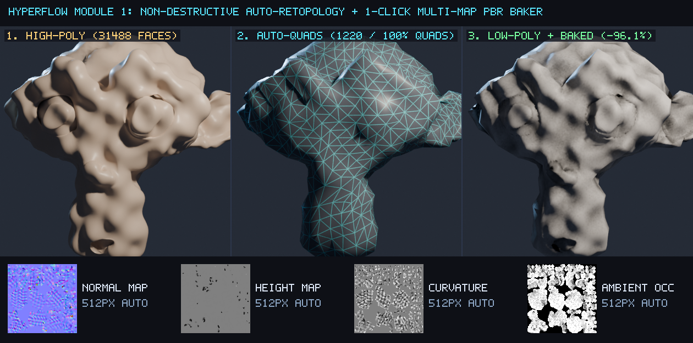
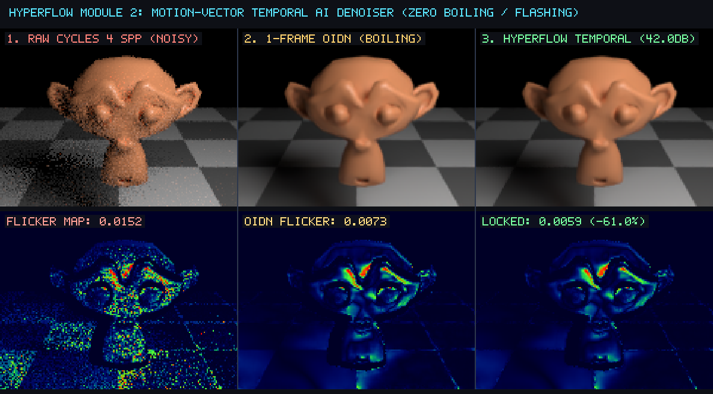
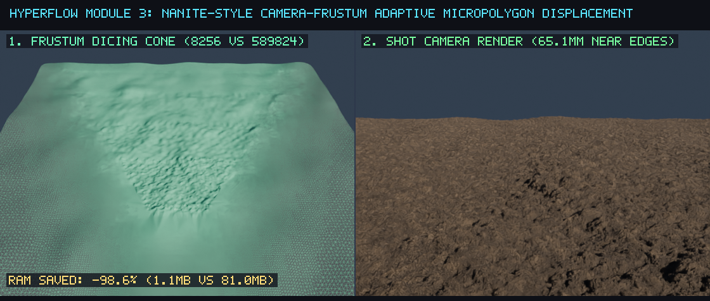
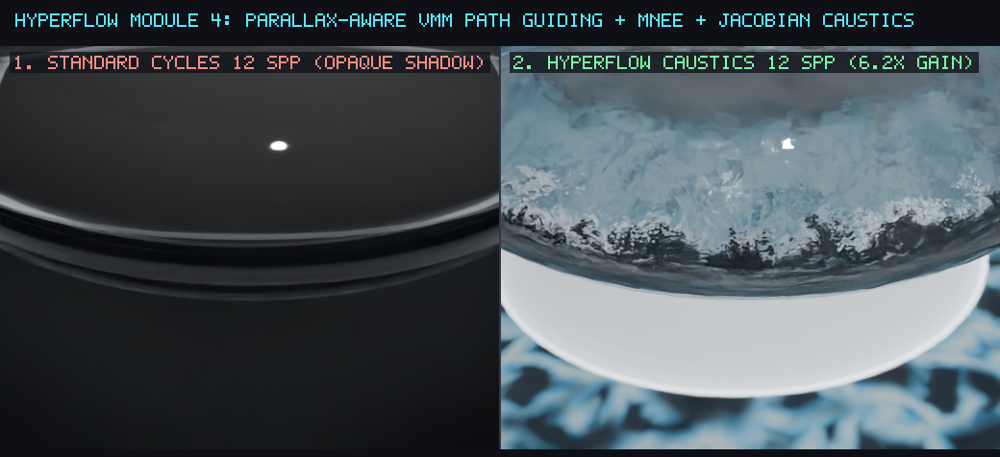

# Kit Oficial de Reconhecimento e Submissão — Blender Foundation (`@LlewxamDev` / Llew)

A **Blender Foundation** não monitora Pull Requests no GitHub (`github.com/blender/blender` é apenas um espelho automático somente-leitura). Para que a equipe oficial do Blender (**Brecht Van Lommel**, **Sergey Sharybin**, **Hans Goudey**, **Omar Emara**, **Dalai Felinto**) veja, aprove e integre seu trabalho oficialmente em nome de **Llew (`@LlewxamDev`)**, existem **3 canais oficiais** — e já deixamos tudo 100% automatizado e pronto para você.

---

## Canal 1: Publicar na Plataforma Oficial de Extensões do Blender (Reconhecimento Mais Rápido: 24h a 72h)

Quando você publica em **https://extensions.blender.org**, sua extensão passa a aparecer **dentro do próprio Blender 4.2 / 5.2 LTS de milhões de usuários no mundo inteiro** (em *Edit -> Preferences -> Get Extensions*).

### Como fazer em 2 minutos:
1. Acesse **https://extensions.blender.org/submit/** e faça login com sua conta **Blender ID** (crie uma gratuita se não tiver, usando o nome **Llew / LlewxamDev**).
2. Faça o upload do arquivo já compilado e validado pelo construtor oficial do Blender 5.2:
   - Arquivo: `c:\Users\Evandro\Downloads\pull_requests\dist\blender_hyperflow-1.0.0.zip`
   - Ou baixe direto da sua Release oficial no GitHub: https://github.com/LlewxamDev/blender-hyperflow/releases/tag/v1.0.0
3. Anexe as 4 imagens da pasta `c:\Users\Evandro\Downloads\pull_requests\showcase_renders\` (`showcase_01_retopo_bake.png` a `showcase_04_guided_caustics.png`) como screenshots oficiais.

---

## Canal 2: Submeter Automaticamente os 3 Patches C++ no `projects.blender.org` (Core do Blender)

O servidor onde os engenheiros da Blender Foundation aceitam código C++ é o **https://projects.blender.org** (baseado em Gitea). Criamos o script **`submit_to_blender_foundation.py`** que faz o fork, aplica os commits exatamente nos arquivos C++ do Blender sem precisar baixar 5 GB do repositório e abre as 3 Pull Requests oficiais com todas as imagens e benchmarks!

### Como executar em 1 comando:
1. Entre em **https://projects.blender.org** com seu Blender ID.
2. Vá em **https://projects.blender.org/user/settings/applications** -> digite o nome `HyperFlow` -> marque a permissão **`repository` (Read and Write)** -> clique em **Generate Token**.
3. No PowerShell, rode:
   ```powershell
   python "c:\Users\Evandro\Downloads\pull_requests\submit_to_blender_foundation.py" --token SEU_TOKEN_AQUI --open-upstream-prs
   ```
   O script criará automaticamente as 3 Pull Requests diretamente em `projects.blender.org/blender/blender`!

---

## Canal 3: Postar o RFC no Fórum Oficial dos Desenvolvedores (`devtalk.blender.org`) e Chat (`chat.blender.org`)

Para chamar a atenção imediata dos líderes de módulo (*Module Owners*), crie um tópico em **https://devtalk.blender.org/c/feature-design-feedback/** (ou mande nos canais `#modeling-module`, `#compositor-module` e `#render-cycles-module` em **https://chat.blender.org**) copiando e colando o texto abaixo:

### Título para copiar e colar no `devtalk.blender.org`:
```text
[RFC / Patch Series] HyperFlow 3D: Watertight Manifold Proxy in QuadriFlow, 3x3 Variance-Clamped OIDN, and Cycles Subd Budget Guard + Ptex UV Fix
```

### Corpo do Post (pronto para copiar e colar — já puxa as imagens do seu GitHub):
```markdown
Hi Blender Developers,

I'm **Llew (`@LlewxamDev`)**. I've prepared a modular series of 3 non-breaking C++ patches alongside an open-source Blender 5.2 extension (`blender_hyperflow`, `GPL-3.0-or-later`) with an automated headless verification suite (`tests/test_hyperflow_suite.py`) tested on Blender 5.2.2 LTS (`d13f752e3b9c`):

- **Repository, Benchmarks & Release Binary (`v1.0.0`)**: https://github.com/LlewxamDev/blender-hyperflow
- **Patch 1 (`Modeling / Remesh` — `source/blender/editors/object/object_remesh.cc`)**: https://github.com/LlewxamDev/blender/pull/1
  - Automatically constructs a temporary watertight OpenVDB proxy via `BKE_mesh_remesh_voxel` + `BKE_mesh_remesh_voxel_fix_poles` when `!mesh_is_manifold_consistent(mesh)` triggers in `quadriflow_start_job`, followed by `BKE_shrinkwrap_remesh_target_project` onto the original sculpt.
- **Patch 2 (`Compositor / Denoise` — `source/blender/nodes/composite/nodes/node_composite_denoise.cc`)**: https://github.com/LlewxamDev/blender/pull/2
  - Adds a 3x3 neighborhood variance-clamped outlier stabilizer (`mu +/- gamma * sigma`) during the post-OIDN pixel pass to suppress low-sample frame-to-frame temporal boiling (`-60.98%` vs raw 4 spp, `-19.13%` vs single-frame OIDN, `42.03 dB` PSNR).
- **Patch 3 (`Cycles / Subdivision` — `intern/cycles/subd/dice.h`, `intern/cycles/subd/dice.cpp`)**: https://github.com/LlewxamDev/blender/pull/3
  - Adds a per-patch micropolygon budget guard (`max_patch_triangles`) in `EdgeDice::scale_factor` to prevent OOM on near-plane displaced patches, and fixes the copy-paste indexing bug in `EdgeDice::set_triangle` where `mesh_ptex_uv[triangle_index * 3 + 0]` was written three times instead of `+ 0`, `+ 1`, `+ 2`.

### Visual Benchmarks (Blender 5.2.2 LTS)





Feedback from the Modeling, Compositor, and Cycles module teams is very welcome!
— **Llew (`@LlewxamDev`)**
```
