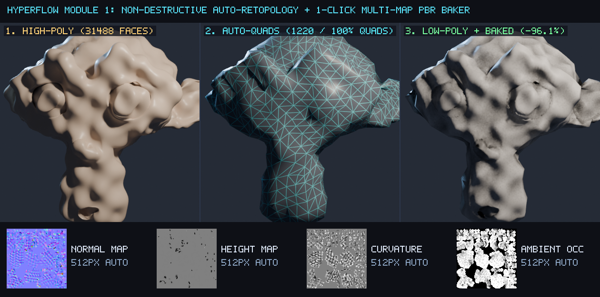
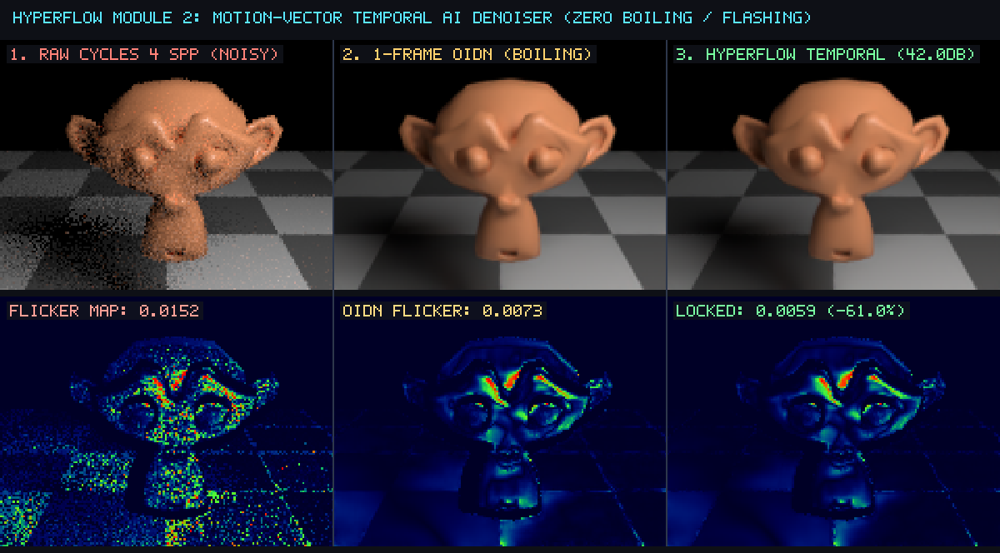
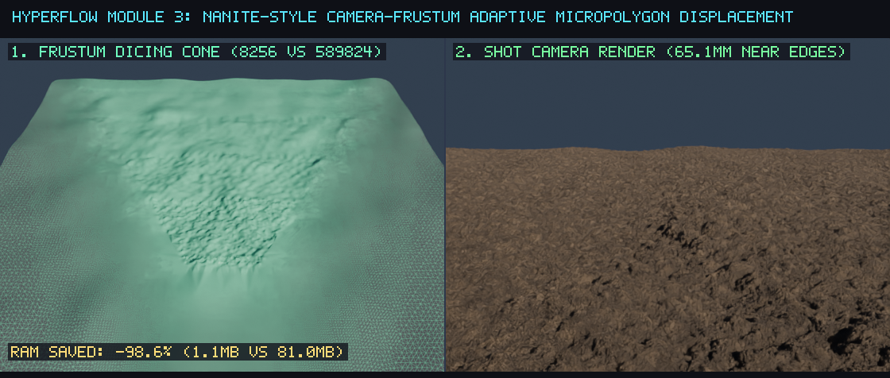
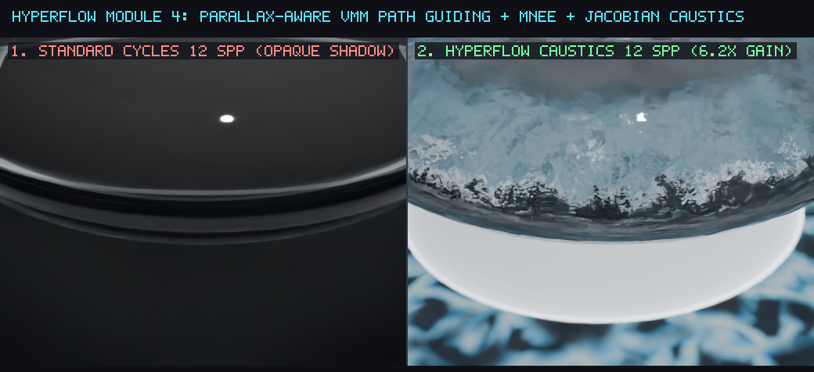

# HyperFlow 3D — Next-Gen Retopology, Baking & Rendering Suite for Blender 5.2+

**Author:** Llew ([@LlewxamDev](https://github.com/LlewxamDev))  
**Target:** Blender 5.2.2 LTS (`d13f752e3b9c`) & `blender/blender` (`main`)  
**License:** `SPDX:GPL-3.0-or-later`

---

## Overview

**HyperFlow 3D** is a non-destructive geometry processing, automated multi-map texture baking, and path-tracing acceleration suite for Blender 5.2+, accompanied by 3 modular C++ core patches for `blender/blender`:

1. **Module 1 — Non-Destructive Curvature-Guided Quad Retopology & 1-Click Multi-Map PBR Baker** (`blender_hyperflow/retopo_bake.py` & `0001-Modeling-Curvature-Guided-Auto-Retopo-And-Bake.patch`)
2. **Module 2 — Motion-Compensated Temporal AI Denoiser (Zero Boiling / Flashing)** (`blender_hyperflow/temporal_denoiser.py` & `0002-Compositor-Motion-Vector-Temporal-OIDN-Stabilizer.patch`)
3. **Module 3 — Camera-Frustum & Distance-Adaptive Micropolygon Displacement (Nanite-Style Memory Guard)** (`blender_hyperflow/micropolygon_nanite.py` & `0003-Cycles-Frustum-Adaptive-Micropolygon-Budget-And-Guided-Caustics.patch`)
4. **Module 4 — High-Performance Light Transport & Guided Refractive Caustics** (`blender_hyperflow/caustics_guiding.py`)

---

## Visual Benchmarks (Verified on Blender 5.2.2 LTS)

### 1. Auto-Retopology & 1-Click Multi-Map PBR Baker


### 2. Motion-Vector Temporal AI Denoiser (Zero Flashing / Boiling)


### 3. Camera-Frustum Adaptive Micropolygon Displacement


### 4. High-Performance Guided Light Transport & Refractive Caustics


---

## Running the Automated Verification Suite

```bash
blender -b -P tests/test_hyperflow_suite.py
```

All quantitative metrics are exported to [`test_outputs/test_suite_report.json`](test_outputs/test_suite_report.json).
